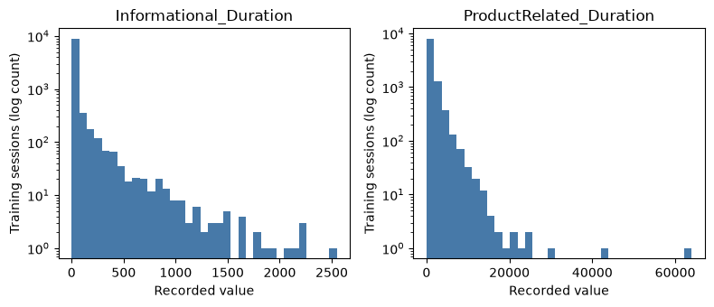
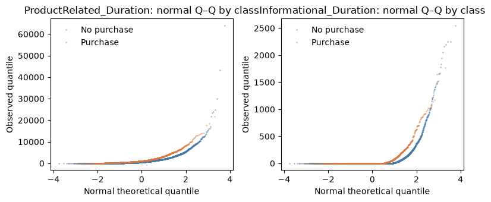
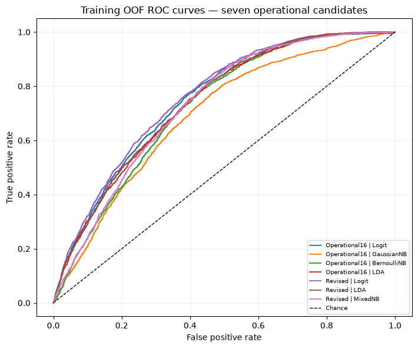
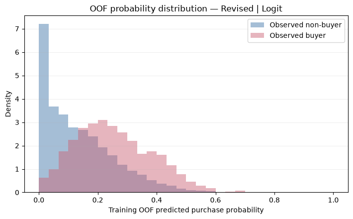
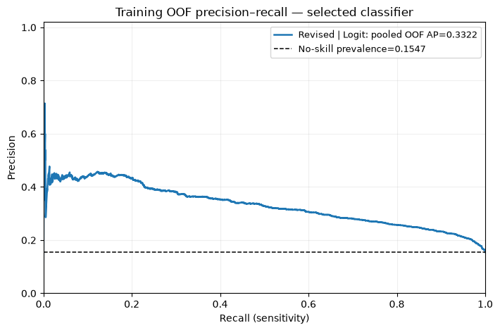
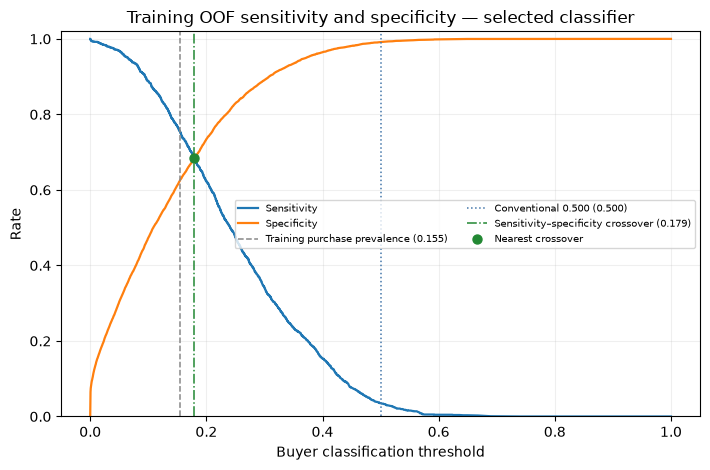

# DSA211 — Executed PRD v2.0 notebook

These are the **actual figures** generated by GitHub Actions from the latest PRD v2.0 notebook on this branch. The original analysis code and dataset have not been changed.

**[View the fully executed notebook, including tables and plots](online_shoppers_revised_executed.ipynb)**

Results reflect the notebook's training-only cross-validation protocol. Figures do not establish independently validated test performance or voucher effects.

## Figures

### 2. Numerical EDA

### 4. Predictor relationships and assumptions

### 8. Model comparison and selection

### 9. Winner OOF probability distribution

### 10. Precision–recall analysis

### 11. Three threshold references — sensitivity and specificity

